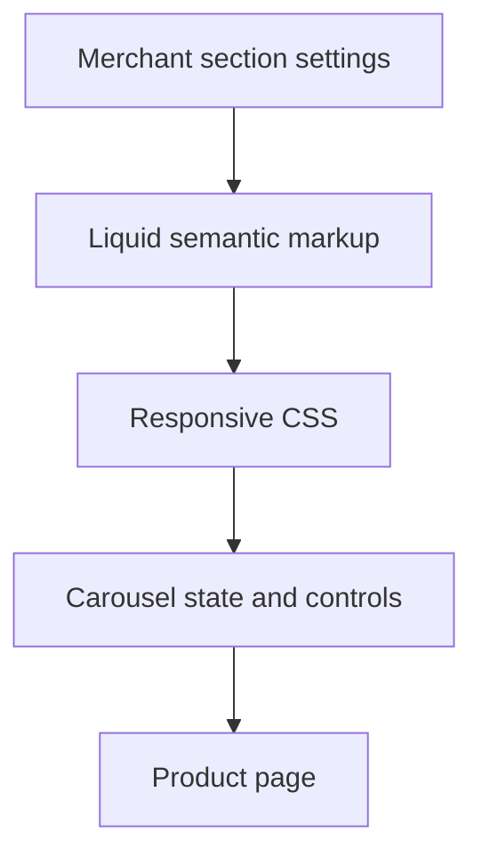

# Shopify Product Storytelling Sections

A cohesive set of native sections for structured comparisons and image-led product storytelling, with editable content and responsive interaction checks.

**Technical showcase · Documentation only · Anonymized**

Shopify Online Store 2.0 | Liquid | JavaScript | CSS | Python | CDP

## Engineering problem

Rich product layouts need to retain semantic structure and merchant editing while supporting narrow screens, rapid interaction and varied image content.

## Implementation scope

- Implemented semantic comparison markup with configurable settings and repeatable row blocks.
- Preserved native product-template composition alongside custom sections.
- Added a configurable carousel with heading, eyebrow, autoplay and interval settings.
- Retained section ordering and source readback evidence through iterative delivery.
- Prepared browser checks across phone, tablet and desktop widths for overflow, image loading and carousel navigation paths.

## Architecture at a glance

The following is an illustrative technical flow, not a client screenshot or a deployment topology.

## Evidence and delivery boundary

Implemented sections with staged preview and restore evidence; permanent production deployment is not asserted.

Contract tests and preview-targeted runtime scripts cover structure, responsive boundaries, image loading and navigation. A runtime test script is not itself a claim that every recorded check passed or that the preview became the permanent live theme.

## Read more

- [Engineering decisions](docs/engineering.md)
- [Scope and evidence boundaries](docs/scope.md)

> This repository describes verified implementation work at a technical level. Original source, identities, business data and visual assets are intentionally omitted. It is not an installable application or a claim that the original private implementation is open source.
