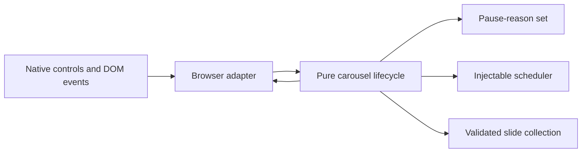

# Shopify Product Storytelling Sections

An anonymized technical showcase with a newly authored, runnable carousel-lifecycle demo for structured product storytelling.

**Technical showcase · Original public demo · Anonymized**

JavaScript | HTML | CSS | Node.js | Accessible interaction design

## Demonstrated mechanism

The runnable demo concentrates on lifecycle behavior that is easy to get subtly wrong:

- explicit, opt-in rotation rather than autoplay on initial load;
- independent pause-reason arbitration for hover, focus, document visibility and reduced motion, plus an internally derived insufficient-slides guard;
- one active timer, reset on navigation, with stale callback invalidation;
- shared active state for previous/next controls and thumbnail buttons;
- dynamic slide replacement that preserves a stable active ID;
- atomic validation for dense collections, bounded 1000–60000 ms demo intervals, navigation targets and exact navigation options;
- manual-only live-region announcements and hidden-panel focus-order management;
- clean browser-adapter disposal for editor-style remounts.

The visual panels use original CSS illustration and illustrative descriptions. They contain no client assets, product claims, store data or private implementation source.

## Run it

Requires a current Node.js release. There are no package dependencies.

```sh
node --test
node demo/run.mjs
node demo/server.mjs
```

Open `http://127.0.0.1:4178/` after starting the server. The static server accepts only GET/HEAD, serves a fixed file surface from this repository, disables caching and sends `X-Content-Type-Options: nosniff`.

## Architecture



## Repository map

- [`src/carousel-lifecycle.mjs`](src/carousel-lifecycle.mjs) — pure state and timer ownership
- [`test/carousel-lifecycle.test.mjs`](test/carousel-lifecycle.test.mjs) — deterministic behavioral tests
- [`demo/index.html`](demo/index.html) — responsive browser review surface
- [`demo/browser-adapter.mjs`](demo/browser-adapter.mjs) — DOM lifecycle integration
- [`docs/carousel-lifecycle.md`](docs/carousel-lifecycle.md) — contracts, focus policy, lifecycle and trade-offs
- [`docs/scope.md`](docs/scope.md) — evidence and publication boundaries

## Evidence boundary

This executable demo is fresh public-showcase work informed by the engineering problem described in this repository. It is narrower than the original private project. It does not reproduce a Shopify theme, prove a production deployment, certify full accessibility or make performance claims. Platform-specific schema, Liquid rendering and Theme Editor event wiring are documented as adapter responsibilities rather than impersonated.
